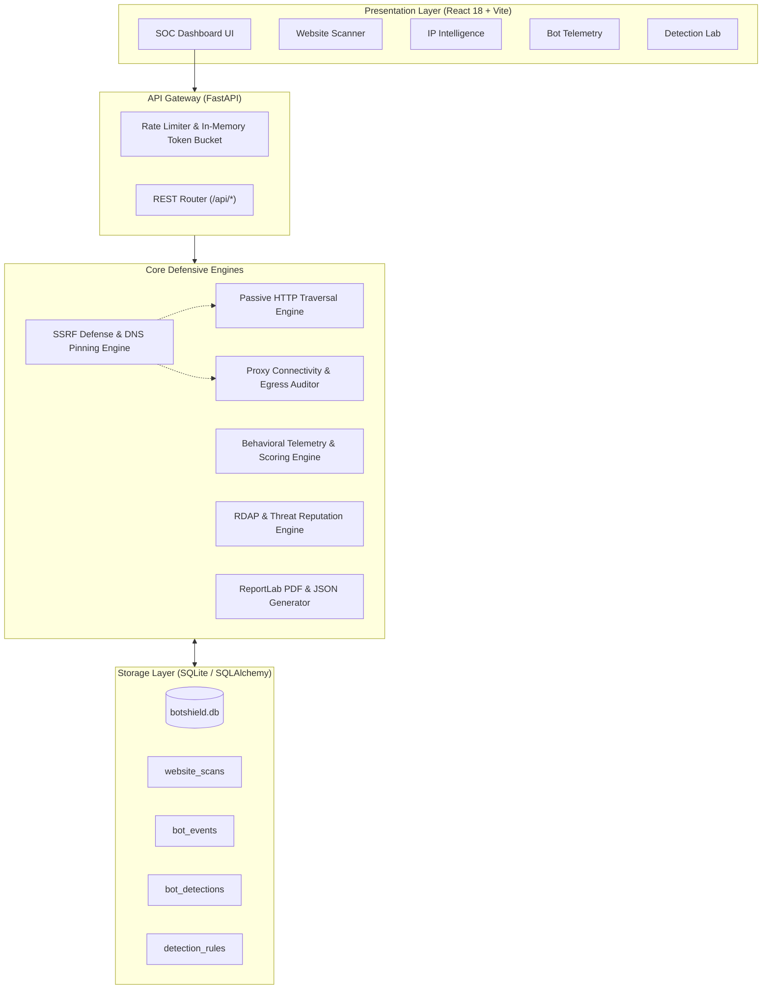

# BotShield System Architecture

## 1. High-Level System Overview

BotShield employs a decoupled, defensive micro-service style architecture comprising a Python/FastAPI backend and a React/TypeScript single-page application.

---

## 2. SSRF Protection Architecture

Outbound request safety is guaranteed through a non-bypassable four-phase validation model in `app.core.security.validate_and_resolve_url`:

1. **Protocol Restriction**: Only `http` and `https` schemes are accepted; `file://`, `gopher://`, `ftp://`, and raw socket protocols are immediately rejected.
2. **Pre-Resolution Hostname Scrubbing**: Disallows localhost aliases (`localhost`, `ip6-localhost`, `127.0.0.1`) and cloud metadata names (`metadata.google.internal`).
3. **DNS Resolution & Exhaustive IP Parsing**: Resolves target hostnames using `socket.getaddrinfo` and inspects **all** returned A and AAAA records against RFC 1918 (Private), RFC 3927 (Link-local), RFC 5737 (Documentation), RFC 6598 (CGNAT), and cloud metadata ranges (`169.254.169.254`, `fd00:ec2::254`).
4. **Hop-by-Hop Redirect Re-Validation**: Prevents redirect-based SSRF by manually disabling automatic client redirects and re-executing full DNS and IP validation on every subsequent `Location` header destination.

---

## 3. Database Schema

All database models reside in `app.models.schema_models` with UTC timestamping and indexing:

* **`website_scans`**: Stores target URLs, final destinations, TLS cipher/version details, response latency, and security scores.
* **`website_findings`**: Relational foreign-key table storing individual header findings, severity levels, observed values, and recommendations.
* **`ip_analyses`**: Historical lookup records with autonomous system numbers (ASN), geolocation, and threat flags.
* **`bot_events`**: High-throughput telemetry table with composite index `(source_ip, timestamp)` for sliding-window queries.
* **`bot_detections`**: Behavioral evaluation snapshots with risk score (0-100), triggered rule lists, and analyst review states.
* **`detection_rules`**: Persistent rule definitions, customizable weights, and dynamic threshold controls.
